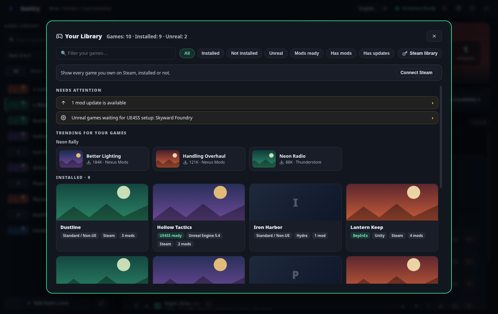
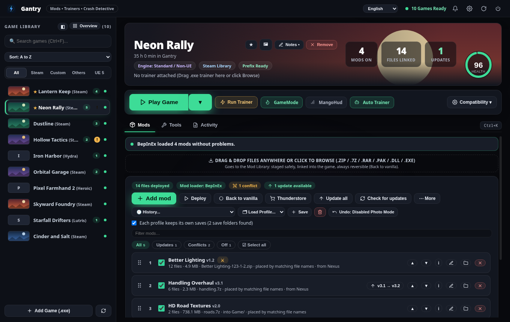
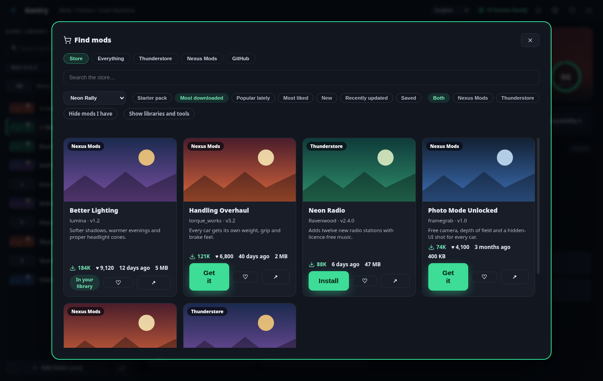
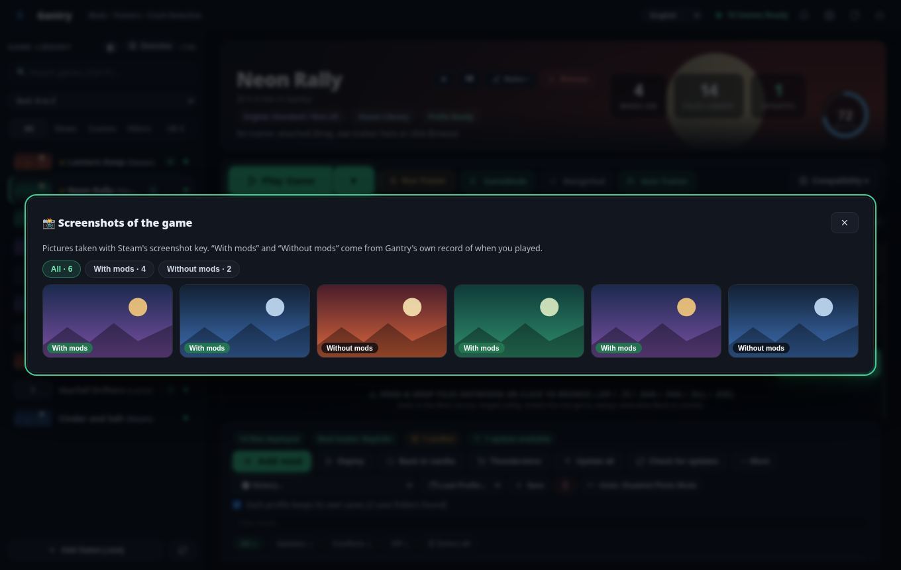
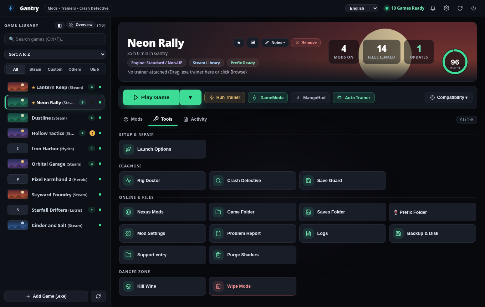

# Gantry

**A mod manager for games on Linux, Windows and macOS, with a Crash Detective that finds the mod that crashes your game.**

Gantry keeps your mods in a library and links them into the game, so **"Back to vanilla" always puts the original files
back**. It finds games from Steam, Hydra, Heroic and Lutris, browses Nexus Mods and Thunderstore, sets up mod loaders
(BepInEx, MelonLoader, UE4SS), backs up your saves and explains what is wrong in plain words. Free and open source, no
telemetry, no account needed.

> **Status: beta.** Gantry is developed and tested on Linux (Steam, Hydra). The Windows and macOS builds are made
> and tested automatically on every change but have had far less use by hand, so please [report what breaks](https://github.com/pigeoonn/gantry/issues/new/choose).
> Your game files are never deleted: mods are linked in and can always be taken out again.
>
> **How it is made:** Gantry is built by David together with [Claude](https://www.anthropic.com/claude), an AI coding
> assistant made by Anthropic. David decides what it should do and tests it on his own games; Claude writes most of the
> code. Everything is open source, so you can read exactly what it does.

## Download

Get it from the **[Releases page](https://github.com/pigeoonn/gantry/releases/latest)**.

| System | How |
|---|---|
| **Linux (any)** | Download `Gantry-*.AppImage`, `chmod +x` it and run it. Or the `tar.gz`, then `./rig --install`. |
| **Arch / CachyOS** | `git clone https://github.com/pigeoonn/gantry && cd gantry/packaging/arch && makepkg -si` |
| **Windows 10/11** | Download the `.zip`, unpack it, run `rig.exe`. Windows SmartScreen may warn because the file is not signed: *More info → Run anyway*. |
| **macOS (Apple silicon)** | `brew install --cask pigeoonn/gantry/gantry` (or the `.tar.gz`, see the [guide](docs/INSTALL.md#macos)). |

Gantry needs `curl`, `bsdtar` (or 7-Zip) and a Chromium based browser (Chrome, Brave, Chromium, Edge) for its window.
Full steps for every system: **[docs/INSTALL.md](docs/INSTALL.md)**.

## Your first ten minutes

1. **Start Gantry.** It finds your games and tells you what each one needs (a mod loader, UE4SS, nothing).
2. **Add a mod:** press the 🛒 button to browse Nexus Mods and Thunderstore, or drag a downloaded `.zip` / `.7z` / `.rar` into the window.
3. **Play.** If a mod misbehaves, press *Back to vanilla*. If the game crashes, open the *Crash Detective*: it switches mods off in halves until it finds the one that did it.

The [tutorial](docs/TUTORIAL.md) walks through it with pictures.

## What you get

**Mods**
- A **mod library** for any game: mods are hard-linked in with a journal and undo, ordered by priority, conflicts shown.
- A **store** for Nexus Mods and Thunderstore side by side, sorted by downloads, with starter packs for some games.
- One-click setup of **BepInEx, MelonLoader and UE4SS**; installer wizards (FOMOD); modpacks and profile codes.

**When things go wrong**
- **Crash Detective** and a health score with one-click fixes; a knowledge base of 26 known problems explained in your language.
- **Save Guard:** saves are backed up before every launch, and can be kept separately per mod profile.
- **Compatibility center:** pick another compatibility tool for a game, download newer builds, switch common fixes on or off.

**Around your games**
- Reads **Steam** (also: tells you when Steam is updating a game, lists Workshop items), **Hydra, Heroic and Lutris**.
- *Why is it slow?*, play time and timeline, a controller mode for the Steam Deck.
- **Ten languages**, dark and light themes, full keyboard use.

Everything in detail: **[docs/REFERENCE.md](docs/REFERENCE.md)**, or one page per feature in the [documentation](docs/README.md).

*The pictures show made-up games and mods.*

## What it guarantees
- **It asks before it guesses.** If a mod's place had to be guessed, Gantry shows where the files would go and waits for your OK.
- **Atomic writes.** Every setting and every edit is written to a temporary file and renamed, so a crash or a power cut cannot leave a half-written file.
- **Steam is never edited without asking**, a backup is kept when it is, and games with anti-cheat are refused.
- **The local web page is locked down:** it listens on `127.0.0.1` only and every call needs a token made at each start.
- **No telemetry.** Gantry talks only to the sites you use (Nexus Mods, Thunderstore, GitHub for updates) and, if you switch it on, VirusTotal (only a file fingerprint).

## Documentation
[Install](docs/INSTALL.md) · [Tutorial](docs/TUTORIAL.md) · [User guide](docs/GUIDE.md) · [Questions and answers](docs/FAQ.md) · [Reference](docs/REFERENCE.md) · [Feature pages](docs/README.md) · [Changelog](CHANGELOG.md)

## Help, ideas, contributing
- **Something broke or a game is not supported?** [Open an issue](https://github.com/pigeoonn/gantry/issues/new/choose). *Tools → Problem Report* copies what is useful to include.
- **Want to help?** Adding a game or a known problem needs no Rust: it is JSON in `data/`. See [CONTRIBUTING.md](CONTRIBUTING.md).
- **Security problem?** See [SECURITY.md](SECURITY.md).

Build from source: `cargo build --release` (needs Rust, and `libwayland-dev` + `libxkbcommon-dev` on Linux), then `./target/release/rig --install`.

## License
Gantry is free software under the **GNU General Public License v3.0 or later** (see [LICENSE](LICENSE)). You can use, study, change and share it; if you distribute a modified version, it has to stay under the same license with its source available.
