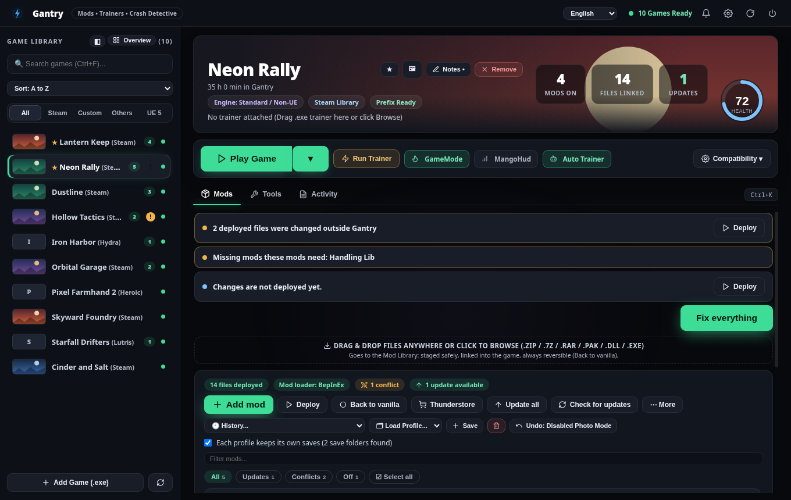

# Gantry user guide

Gantry manages mods, trainers and compatibility settings for your games on Linux. Everything it does to a game
is reversible: **Back to vanilla** removes every mod file and puts the original files back.

## The screen
- **Left:** your games (Steam, Hydra, Heroic, Lutris and ones you add yourself). A small chip marks games that need
  attention. Right-click a game for Play, Game Folder, Pin and Remove from the list. Sort and search above the list.
- **Top of a game:** cover, last played, time played in Gantry, the Play button (the arrow next to it plays
  without mods or with a saved profile), and the compatibility button.
- **Tabs:** **Mods**, **Tools**, **Activity**. **Ctrl+K** searches games and every action; **?** lists the shortcuts.

## Adding mods
1. Drop a `.zip`, `.7z`, `.rar`, `.pak` or `.dll` anywhere in the window, press **Add mod**, or use **Thunderstore**
   (the *Find mods* window also searches Nexus Mods trending lists and GitHub releases).
2. Gantry works out where the files go: from the mod's own folders, from files of the same name the game already
   has, or from the mod's readme / Nexus page. When it had to guess, it **asks first**; you can accept, pick another
   folder, or cancel.
3. Mods are kept in a library and linked into the game. Reorder them with ▲▼, switch them off, pick which mod wins
   a single conflicting file, or write a note on a mod (✎).

Useful buttons: **Deploy**, **Back to vanilla**, **History…** (go back to any earlier state of the list),
**Load Profile…**, **More** (share or import a setup, fix placement, open the folder).

## The mod page

Press **ℹ** on a mod in the library. For a mod from Nexus Mods or Thunderstore you see the author's page:
the description, what changed in each version (newest first, the version you could update to is marked), what
the mod needs (and which of those you already have), the files Gantry placed and the instructions that came
with it. If a newer version exists the page has an **Update** button. Mods you added by hand have a page too,
with their files and instructions. Nexus pages need your Nexus key; without it, or without internet, you see
what Gantry knows and a note saying why. Pages are kept for ten minutes, so opening one again is instant.

### Starting a game without opening Gantry

The arrow next to **Play** has *Create a shortcut for this game*: a launcher named “Game (Gantry)” appears in
your application menu (and on the desktop when you have a Desktop folder). It runs `rig --play <id>`, which
starts Gantry quietly in the background if it is not running, puts the mods in place, starts the game, and
closes itself a little after the game ends. In a terminal: `rig --play "Schedule I"`, `rig --play 3164500
--vanilla` (without mods), `rig --play 3164500 --profile "Only fixes"`. A name only has to be unique:
`rig --play schedule` works.

### Updates, on your terms

On a mod's page (ℹ) the menu next to the buttons chooses what happens when a newer version appears: **tell me**
(the default: an update button and a notification), **update automatically** (Gantry installs it when no game
is running) or **keep this version** (you are never bothered; a 🔒 shows in the list). After an update the
mod page lists the earlier versions Gantry kept (the last two) with **Go back to v…**; the version you leave
stays available, so a rollback can be undone too.

### Mods with an installer

Some mods come with their own installer script (a `fomod` folder inside the archive). Instead of putting the
files straight into the library, Gantry shows the installer's pages: pick an option to read what it does and
see its picture, press **Next**, and **Install** at the end. Options the script marks as required are ticked
for you, options that cannot work with your game are greyed out. Your answers are saved with the mod; when
you update it, Gantry uses them again and asks nothing. If a script is damaged or Gantry cannot follow it,
the mod's files are added as they are and a note in the activity log says why.

### Safety checks on mods

Downloads from Nexus Mods are compared with the checksum Nexus published; a file that does not match is thrown
away and nothing is installed. On the mod page you see **✔ Checksum verified** when it matched. A mod with
program files inside (`.exe`, `.bat`, `.cmd`, `.ps1`...) gets a **⚠ Contains programs** mark, because a mod
rarely needs one: keep it only when you trust where it came from. Thunderstore and GitHub do not publish a
checksum Gantry can compare with, so those mods show no checksum mark.

## Games that need a mod loader (Unity)
For Unity games Gantry shows a card with the loader that fits (BepInEx 5, BepInEx 6 or MelonLoader) and installs it in
one click. Start the game once afterwards: the first start can take a while.

## Game health

When the logs of a game name a problem Gantry knows (a missing library a mod needs, a loader built for the wrong
kind of game, a MelonLoader first-start failure, a missing Windows runtime in the prefix, Vulkan not starting,
a crash, a full disk, anti-cheat...), the health bar shows it in plain words with **what to do** and the log
line it found; while the game runs, a new one arrives as a notification. Gantry knows 121 problems from the logs of
Unity and Unreal games, BepInEx, MelonLoader, UE4SS, SMAPI, SKSE/F4SE, the Cyberpunk tools and Wine. You can teach
it more: put an `errors.json` next to its settings file with entries like
`{"id": "my-problem", "logs": ["player"], "contains": ["some text"], "unless": ["other text"], "level": "warn",
"title": "...", "cause": "...", "fix": "..."}`; an entry with the id of a built-in one replaces it, and a text may be a map of
language codes (`{"en": "...", "ro": "..."}`).

The bar at the top of the Mods tab says what is wrong, worst first, with a fix button: a frozen game (Stop), a
missing Steam launch option for the account you are logged in with, files changed by a game update (Deploy), mods
needing other mods, anti-cheat games (play without mods). **Tools → Problem Report** copies a report you can paste
when asking for help (it contains no keys).

## The new look and the new tools

**Library as covers.** The button next to *Overview* switches the game list between rows and a grid of cover art (Steam portrait art, or a coloured tile for games without art). The choice is remembered.

**Health ring.** The ring on the game page is 100 when nothing is wrong. It drops for every problem on the Mods tab (a problem that blocks the game counts most, updates waiting count a little). Click it to jump to the list. *Fix everything* does every safe fix in order; the Steam launch-option fix still asks before it closes Steam. *Find the broken mod* opens Crash Detective, which turns mods off and on in rounds.

**Check my games.** Opens after the first-run tour, and any time from Settings or Ctrl+K. Each game gets one verdict: *Ready for mods*, *Needs a mod loader* (the right one for IL2CPP or Mono is suggested), *Needs UE4SS* (open the game's Tools tab) or *Protected by* an anti-cheat (Gantry will not put mods there). *Set up all* installs the loaders one game at a time and puts your selection back afterwards.

**Mod list.** Drag the ⠿ grip to change the load order. Click a mod's number to select it (Shift-click for a range); the bar above the list then offers *Turn on*, *Turn off*, *Group…* and *Remove*. Groups are labels for sorting: the chips above the list (*Updates*, *Conflicts*, *Off* and one per group) filter the list without changing the order. Anything you remove goes to the library trash; the *Undo* toast that follows brings it back. Long lists show 150 rows at a time with *Show more*.

**Downloads.** The ⬇ button in the top bar appears when something was downloaded. It lists progress, speed and time left, errors in plain words and a *Cancel* button.

**Modpacks.** In the mod list, *More → Share as modpack* writes a `.gantrypack` (a zip) with `pack.json` (the list: name, version, on/off, folder, group, note, and where each mod comes from) and, under `mods/`, the files of mods that cannot be fetched again. Nexus Mods files are never copied into it. Send it to a friend; their *More → Import a modpack* adds the files that came along, installs the Thunderstore mods with their dependencies, and puts a bar above the list with what is still missing and a *Get all* button (with a free Nexus account each page opens and you press *Slow download*). As each mod arrives it takes its order and its on/off state from the modpack, and the bar goes away when everything is there.

**Play time.** *Activity* now starts with your time in the game (or in all games), the number of crashes, how much you played with mods, the last 14 days as a chart, and a timeline mixing your sessions with changes to the mod list.

**VirusTotal (optional).** Off until you switch on *Settings → Check program files with VirusTotal* and add your own free key (Gantry stores it in a private file and never shows it). On the *Files* tab of a mod with program files (`.exe`, `.bat`…) a *Check with VirusTotal* button asks about them. **Only the SHA-256 fingerprint of each program file is sent**: not the file, not its name, not your game. Answers are kept for a few days, free keys are limited to four questions a minute (Gantry waits between them), and a flagged file also shows up in the notification bell. A file VirusTotal has never seen is shown as "not known", which is not the same as safe.

**Keyboard and screen readers.** Every button, field and list has a name a screen reader can say, dialogs announce themselves, take the focus when they open, keep Tab inside and give the focus back when they close, and things that look like buttons work with Enter and Space. Text colours are fitted to each theme (also your own) so muted text, accent text and status colours keep a contrast of at least 4.5:1; *Stronger text and borders* in Settings goes further. The screen test fails when a control has no name or a text is too faint in any theme.

**Why is it slow?** The *Activity* card has a *Why is it slow?* button. While a game runs (Linux) Gantry notes the most memory it used and how busy the processor was; after the session this is kept with it. If MangoHud wrote a log in that time (press Shift+F2 in the game; Gantry looks in the folder named in `MangoHud.conf`, your home folder, `~/MangoHud` and `/tmp/MangoHud`), frame rate, the slowest 1 %, stutters and the slowest frame are added, and you can open any MangoHud log by hand. Modded and plain sessions are averaged apart, and the enabled mods that are big or run code are listed with a *Switch off* button so you can compare. These are hints, not a diagnosis.

**Conflict viewer.** When two mods provide the same file, the list shows ⚔ and an *Open the conflict viewer* button. It says who overwrites whom (with how many files), warns about a mod that has no effect because every file of it is replaced, lets you make one mod win against another in one click, and searches every conflicting file by path or mod name. A click on a mod name pins that file to it; *Back to the load order* forgets your choices.

**Automatic backups.** Once a week Gantry copies your settings and every game's mod list; *Tools → Backup & Disk* lists the newest 8 and restores one (the current settings are kept in the cache folder first). *Settings → Back up Gantry every week* switches it off. Saves are also copied after every play session, when they changed, and show up in *Save Guard* as "after the session".

**Storage.** *Tools → Backup & Disk* has a bar showing where the space goes (mods, trash, profile saves, downloads), says how much space hard links save, and can delete copies of replaced saves older than 30 days.

**Controller mode.** Start with `rig --deck`, or switch it on in Settings. Controls get bigger, a bar at the bottom shows the buttons, and a gamepad does everything: D-pad or left stick moves, A selects, B goes back or closes, X plays, Y opens search, LB and RB switch tabs, Menu opens your games, the right stick scrolls.

**Look.** Settings has a theme gallery (dark: Gantry, Midnight, Ember, Forest, Ocean; light: Light, Paper, Mist, Sand; follow the system; or Custom, made from one colour, a roundness and light or dark), an accent colour (or *Accent follows the game*), Motion (full, calm, off) and Compact lists.

**The store.** *Find mods → Store* lists mods of the selected game from Nexus Mods and Thunderstore as cards. The chips sort by most downloaded, popular lately (most downloaded among mods changed in the last six months), most liked, new and recently updated; the source chips pick one site or both; the box narrows by category; *Hide mods I have* removes what is already in your library. Clicking a card opens the mod's page before you install anything. With a free Nexus account *Get it* opens the mod's page and Gantry takes the file when you press *Slow download*. *Starter pack* lists mods worth beginning with; *Get all* fetches them one after another. Mods their authors marked as adult stay hidden unless Settings → *Show adult mods in the store* is on. In the overview every installed game has a 🛒 button that opens the store for it.

## Compatibility
The button next to Play opens **Compatibility**: choose the compatibility tool for the game (for Steam games this is
Steam's own setting, changed only while Steam is closed, with a backup), download the newest GE build, and switch
on common fixes (NT sync off, OpenGL, Wayland…).

## Finding mods

Thunderstore works for games that have a community there (found by the game's name, or set in `recipes.json`).
Nexus Mods lists need your API key (*Nexus Mods* tool); Premium accounts can install straight from the list and
install the mods a mod requires, free accounts download from the website and Gantry takes over.

### Plugins and load order

For Skyrim Special Edition and VR, Fallout 4 and Starfield the Tools tab has **🔌 Plugins**. It shows every plugin in
the game's `Data` folder in the order the game loads them (the game's own files first, always on), with a tick for
each one that is switched on. Gantry reads each plugin's header, so it can tell you when a plugin needs another that is
not installed, or loads before something it needs. **Sort for me** puts masters first and every plugin after the ones
it needs, changing as little as possible and keeping what you ticked; the arrows move one plugin. **Save** writes the
game's `plugins.txt` (the first version is kept as `plugins.txt.gantry-orig`). Nothing is written while the game is
running. Older games (Oblivion, Fallout 3, New Vegas, Skyrim LE) and LOOT's sorting rules are not covered.

### Saves that follow the profile

Mods can change what a save holds, and a save written with mods often does not load without them. In the Mod
Library, **Each profile keeps its own saves** (shown when Gantry can see the game's save folders) makes switching
profile switch the saves too: the current ones are put away under the old profile's name, the new profile's come
back, and a profile with no saves yet starts from what is there. *Play without mods* gets saves of its own, and your
modded ones return when the session ends. Whatever is replaced is first copied into
`profile_saves/_replaced/<time>` next to the library, and nothing is switched while the game is running. Unreal
`SaveGames` folders are found by themselves; for other games add `saves` to the game's support entry, e.g.
`"saves": ["{documents}/My Game", "{appdata_locallow}/Studio/Game"]` (starting points: `{documents}`, `{saved_games}`,
`{appdata_local}`, `{appdata_locallow}`, `{appdata_roaming}`, `{game}`, `{home}`).

### Teaching Gantry about a game

*Tools → Support entry* opens what Gantry knows about the selected game as a small text you can edit: `loader`
(`bepinex5`, `bepinex6` or `melonloader`), `thunderstore` (the game's community name), `nexus` (the part after
`nexusmods.com/`), `folders` (files with these extensions go into that folder when a mod has no folders of
its own and nothing else decides, e.g. `{"ext": ["bndl"], "folder": "VEHICLES"}`) and `notes` (a tip shown
with the game). If the game has no entry yet you get a draft made from what Gantry can see. Press Save and
it is used at once; entries are kept in `recipes.json` next to the settings and can be shared.

### Searching

The first tab of *Find mods*, **Everything**, searches Nexus Mods, Thunderstore and your own library with one
box. Results show their source; **Install** does the right thing for each (Nexus: the main file with Premium,
otherwise the mod's page). The Nexus tab alone also searches by name now, not just the trending lists.

### Tracked mods and collections

In the Nexus tab of *Find mods*, the list menu has **Tracked**: the mods on your Nexus tracking list for this
game. The **📚 Collection** button takes a collection link (from the collection's page on Nexus Mods). Gantry
shows its mods, marks the ones you already have, and with Nexus Premium installs the missing ones for you
(optional mods only if you ask). With a free account it opens the next missing mod's page; press
*Mod Manager Download* there and Gantry takes over. Open a mod's page (ℹ) to **endorse** or **track** it.

## Steam, Workshop and downloads
Gantry only reads what Steam keeps; it never changes Steam's files. **Updates:** when Steam is downloading, unpacking or checking a game, the game page says so and *Play* waits (starting then would run half-updated files). **Workshop:** for games whose mods come from the Steam Workshop, *Tools → Workshop* lists the installed items with name, picture and size (Steam still downloads and updates them). **Steam Cloud:** next to *Each profile keeps its own saves* a note appears when Steam Cloud syncs the game, because Steam can then ask which copy to keep. **Trending:** the overview shows the most downloaded recently changed mods of the three games you played last. **Downloads:** *Settings → Download speed limit* caps each download; *Wait for the game to close before downloading* holds new downloads while a game runs.

## Tools
Launch Options, Rig Doctor, Crash Detective (finds the mod that crashes a game), Save Guard, Mod Settings (edit
`.cfg`/`.ini` files of mods), Problem Report, **Backup & Disk** (backup file of all your settings, notes and mod lists;
disk use; cleanup), Compatibility, **Workshop** (Steam Workshop items of the game), and quick folder buttons: the game's
folder, its saves (when Gantry knows where they are) and its Wine prefix (Linux). *More → Copy the mod list* copies your
switched-on mods as a plain list for a chat or a post. In a terminal, `rig --doctor` prints every installed game with
its loader, its mods and what is wrong.

## Files and safety
- Settings: `~/.config/protonrig/`. Your own game knowledge goes in `recipes.json` there
  (`{"games":[{"appid":"123","loader":"bepinex5","thunderstore":"some-community"}]}`).
- Nothing is written to Steam's settings while Steam runs, and every change to them is backed up first.
- Games with anti-cheat (Easy Anti-Cheat, BattlEye) are refused unless you insist.
